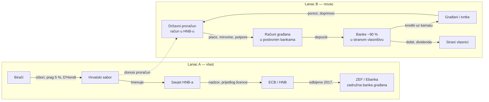

# 1. Trenutno stanje — činjenični lanac, korak po korak

Stanje na dan 2026-10-18. Brojevi u uglatim zagradama, npr. [S3], vode na
[izvore](05-izvori.md). Stavovi su označeni kao **Stav:**.

Dva lanca, koja se spajaju u istoj točki: **tko upravlja novcem građana i
po kojem pravilu glasa.**

---

## Lanac A — glas građanina ne vrijedi jednako, a ta vlast bira Savjet HNB-a

### A1. Kako se biraju zastupnici

- Sabor ima 151 zastupnika: 140 iz 10 izbornih jedinica (po 14), 3 iz
  jedinice za dijasporu, 8 iz jedinice za nacionalne manjine [S10].
- U svakoj od 10 jedinica: lista s jednim preferencijskim glasom,
  **prag 5 %** unutar jedinice, mandati se dijele **D'Hondtovom metodom**
  samo među listama iznad praga [S10][S11].
- Ustavni sud je u veljači 2023. ukinuo zakon o izbornim jedinicama jer se
  težina glasa previše razlikovala između jedinica; nove granice vrijede od
  izbora 2024. [S10][S11]. To je popravilo nejednakost **između** jedinica,
  ali ne i nejednakost koju stvaraju prag i D'Hondt **unutar** jedinice.

### A2. Matematika praga: glas vrijedi između 0 i ~20

Primjer koji se može provjeriti olovkom, u jednoj jedinici sa 14 mjesta:

| Lista | Glasova | Udio | Prolazi prag 5 %? | Mandata |
|---|---:|---:|---|---:|
| Stranka A | 1.000 | 5,0048 % | da | **14 / 14** |
| 19 stranaka, svaka | 999 | 4,9997 % | ne | 0 |
| **Ukupno** | 19.981 | 100 % | | 14 |

- Lista s **5,0048 %** glasova dobiva **100 %** mandata te jedinice.
- Glas birača stranke A vrijedi 100 / 5,0048 ≈ **20 puta** više od
  proporcionalnog. Glas svih ostalih birača (94,99 %) vrijedi **0**.
- Kad bi se isto ponovilo u svih 10 jedinica, ta lista bi s ~5 % glasova
  imala 140 od 151 zastupnika (**92,7 %**), dakle više od ustavne
  dvotrećinske većine, na 4 godine, s cijelim državnim proračunom i pravom
  da imenuje Savjet HNB-a.

Ekstrem je teorijski, ali mehanizam radi i u stvarnosti, samo blaže.

### A3. Stvarni rezultat: izbori 17. 4. 2024. [S12]

| Lista | Udio glasova | Mandata | Udio mandata |
|---|---:|---:|---:|
| HDZ i koalicija | 34,42 % | 61 | 40,4 % |
| Rijeke pravde (SDP i koalicija) | 25,40 % | 42 | 27,8 % |
| DP i koalicija | 9,56 % | 14 | 9,3 % |
| Možemo! | 9,10 % | 10 | 6,6 % |
| Most i koalicija | 8,02 % | 11 | 7,3 % |
| Fokus–Republika | 2,25 % | 1 | 0,7 % |

- HDZ: 34,42 % važećih glasova → 40,4 % mandata. Mjereno prema svim
  upisanim biračima I.–XI. jedinice, to je **20,7 % biračkog tijela**
  (729.949 / 3.523.270) [S21].
- **236.881 glas (11,39 %)** dan je listama ispod praga u svojoj jedinici, a
  270.135 (12,98 %) listama bez ijednog mandata u jedinici: ti glasovi nisu
  pretvoreni ni u jedan mandat [S21].
- Gallagherov indeks nerazmjernosti 2024.: **7,04** (iznad 5 znači visoka
  nerazmjernost; razmjerni sustavi su obično ispod 2–3) [S21].
- Vladajuća većina **HDZ + DP: 43,98 % glasova → 75 mandata** (49,7 %), uz
  potporu manjinskih zastupnika većina u Saboru. Manjina birača daje većinu
  vlasti.

### A4. Taj Sabor imenuje Savjet HNB-a

- Savjet HNB-a ima 8 članova: guverner, zamjenik guvernera i 6
  viceguvernera, mandat 6 godina [S4][S5].
- Sve ih imenuje **Hrvatski sabor**, na prijedlog Odbora za izbor,
  imenovanja i upravne poslove, uz mišljenje Odbora za financije i državni
  proračun [S5].
- Dakle: izborni sustav iz A2/A3 → saborska većina → Savjet HNB-a.

### A5. Građani su pokušali osnovati vlastitu banku: ZEF / Ebanka

- **ZEF – Zadruga za etično financiranje** osnovana je 2014. u Zagrebu s
  ciljem osnivanja prve etične banke u Hrvatskoj [S6][S7]. Zadruga: jedan
  član, jedan glas, jednak temeljni ulog za svakog člana (danas 331,81 €) [S7].
- Članstvo: oko 1.400 (2018., prema izjavi u [S2]); ZEF danas navodi 814
  članova i opisuje se kao najveća zadruga u Hrvatskoj [S7]. Brojke se
  razlikuju po izvoru i godini **[provjeriti]**.
- **11. 10. 2016.** ZEF podnosi HNB-u zahtjev za odobrenje za rad
  „Ebanka d.d." [S2].
- **2017.** HNB odbija zahtjev. Razlozi koje je HNB naveo [S1][S3]:
  - nije dokazano da je prikupljen **minimalni temeljni kapital**
    (tada 40 milijuna kuna, ≈ 5,3 mil. €, čl. 19. Zakona o kreditnim
    institucijama) [S2];
  - nije dokumentirano kako je kapital prikupljen;
  - neodgovarajuća planirana kadrovska ekipiranost;
  - sumnja u stabilnost modela jer članovi zadruge mogu povući udjele.
- ZEF: rješenje je stiglo tri tjedna prije roka i dan prije sastanka na
  kojem se kapital trebao prikupiti; nije pokrenut upravni spor [S1][S2].
- **2017.–2018.** ZEF pokušava dokapitalizirati Tesla štednu banku;
  **22. 2. 2018.** HNB predlaže stečaj Tesle [S2].
- Danas ZEF razvija inicijativu Europske etične banke; licenca u Hrvatskoj
  nije dobivena [S7].

### A6. Tko danas odlučuje o licenci

- Od 1. 10. 2020. Hrvatska je u bliskoj suradnji s ECB-om, a od 1. 1. 2023.
  u europodručju [S8].
- Po Uredbi o SSM-u (EU 1024/2013, čl. 4. i 14.) **odobrenje za rad svake
  kreditne institucije daje ECB**, na prijedlog nacionalnog nadzornika
  (HNB) [S9]. Minimalni početni kapital banke u EU je 5 milijuna € (CRD,
  čl. 12.).
- Znači: ZEF je 2017. odbio HNB sam; novi zahtjev danas bi išao preko HNB-a
  na odluku ECB-a.

**Stav:** Formalno je odbijenica imala navedene razloge. Sustavno gledano,
prag od ~5 milijuna € kapitala, uz pravila pisana za dioničke banke, čini
banku u vlasništvu građana po načelu „1 član, 1 glas" gotovo nemogućom, dok
je za kapital stranih bankarskih grupa trivijalan.

---

## Lanac B — novac građana kruži kroz strane banke

### B1. Porezi ulaze u proračun

- Država ubire poreze i doprinose; plan ukupnih prihoda državnog proračuna
  za 2025. bio je ~33 milijarde € [S15].
- Svi priljevi i odljevi državnog proračuna idu preko **jedinstvenog računa
  državnog proračuna koji se vodi u HNB-u** [S16].

### B2. Proračun se isplaćuje građanima, novac postaje depozit u bankama

- Plaće u javnom sektoru, mirovine, potpore i plaćanja dobavljačima
  isplaćuju se na račune građana i tvrtki u poslovnim bankama.
- Ondje taj novac postaje **depozit**, tj. izvor likvidnosti banke.

### B3. Banke su ~90 % u stranom vlasništvu

- Banke u stranom vlasništvu već godinama drže oko **87,5–90 % imovine**
  bankovnog sustava, pretežno talijanske i austrijske grupe [S13][S14].
- Upravljanje dioničkim društvom: glas ima **dionica**, ne osoba.

### B4. Banke plasiraju tu likvidnost istim građanima kao kredit

- Građanin koji treba novac za investiciju ide u poslovnu banku. Nema
  institucionalnog puta da zajednica građana izravno posudi građaninu.
- HBOR (državna razvojna banka) velik dio kredita plasira **preko**
  poslovnih banaka **[provjeriti udio]**.

### B5. Kamatna marža postaje dobit, dobit postaje dividenda

| Godina | Dobit banaka u RH | Izvor |
|---|---:|---|
| 2023. | 1,36 mlrd € (+91,2 %), ROE 15,5 % | [S17] |
| 1.–9. mj. 2024. | 1,2 mlrd € | [S18] |
| 1.–9. mj. 2025. | 1,13 mlrd €, ROE 15,5 % | [S17] |

- 2009.–2018. banke su isplatile ~18,9 milijardi kuna dividendi, većinom u
  inozemstvo [S14].

### B6. Dokaz da izravni put postoji: narodna obveznica 2023.

- U ožujku 2023. država je prvi put posudila **izravno od građana**:
  44.843 građana upisalo je 1,335 milijardi € na 2 godine uz **3,65 %**
  godišnje; ukupno izdanje 1,85 mlrd € [S19].
- Kamata je otišla građanima (48,7 mil. € kamate građanima), ne
  posredniku [S19].

**Zaključak lanca B (stav):** Infrastruktura za izravni tok novca
građanin ↔ država već je postojala za *posuđivanje državi*. Ne postoji
obrnuto: građanin ↔ zajednica građana za *investiciju građanina*. Taj
smjer drži privatni, većinom strani, posrednik.

---

## Što ovaj dokument ne tvrdi

- Ne tvrdi da je HNB odbio ZEF bez navedenih razloga; razlozi su gore.
- Ne tvrdi da banke doslovno posuđuju „porezni novac". Tvrdi da proračunske
  isplate završavaju kao depoziti u bankama, a banke kreditiraju iz svoje
  bilance (i stvaraju novac kreditom).
- Ne tvrdi da je izborni ekstrem iz A2 stvarno nastupio; A3 pokazuje
  stvarni, blaži učinak istog mehanizma.
- Državni proračun je u deficitu [S15], pa „posuditi iz proračuna" ne znači
  posuditi iz viška, nego **promijeniti tko upravlja tokom kredita**. Vidi
  [rješenje](02-rjesenje-1-osoba-1-glas.md) i [P2P likvidnost](03-rjesenje-p2p-likvidnost.md).
