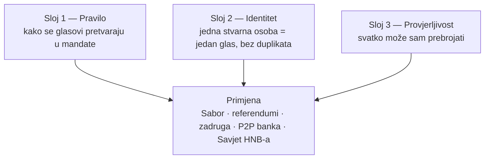
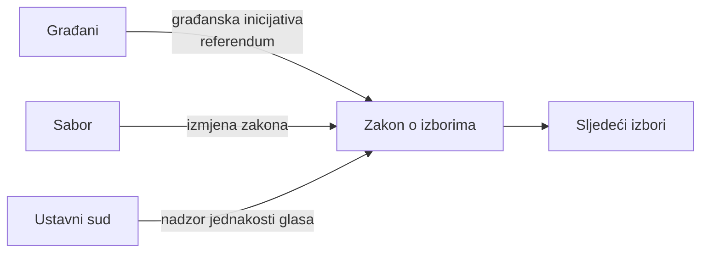
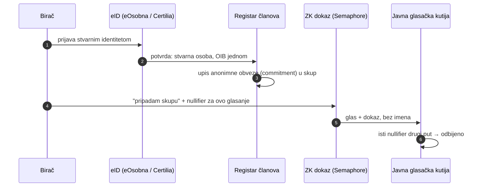
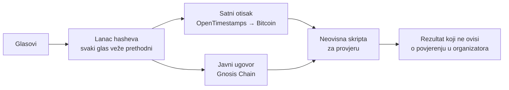

# 2. Rješenje: 1 osoba = 1 glas

Blueprint, ne implementacija. Problem je opisan u
[01 — lanac A](01-trenutno-stanje.md).
Gradivni blokovi koji već postoje su u [04](04-gradivni-blokovi.md).

## Načelo

> Svaki glas ima istu težinu, na izborima i u upravljanju javnom
> infrastrukturom. Mjera uspjeha je broj, ne dojam: **glas vrijedi 1, a ne
> 0 ili 20.**

Tri sloja, svaki rješava drugi dio problema:

---

## Sloj 1 — Pravilo: razmjernost koja se mjeri

### Cilj, mjerljivo

| Mjera | Danas (2024.) | Cilj |
|---|---:|---:|
| Gallagherov indeks | 7,04 | < 2 |
| Glasovi koji nisu pretvoreni ni u jedan mandat | 11,4–13,0 % | < 2 % |
| Najveći omjer % mandata ÷ % glasova | 1,24× | ≈ 1,0× |
| Teorijski najgori slučaj po jedinici | ~20× i 0× | ≈ 1× |

### Opcije (svaka se može izračunati simulatorom, vidi [04](04-gradivni-blokovi.md))

| Opcija | Što mijenja | Dobitak | Cijena / rizik |
|---|---|---|---|
| **A. Jedna nacionalna jedinica** | 140 mandata dijeli se na razini RH | Nestaje efekt praga po jedinici; prirodni prag ≈ 0,7 % | Slabija veza zastupnik–regija (ublažava se preferencijskim glasom) |
| **B. Kompenzacijski mandati** (nordijski model) | Zadrži 10 jedinica, dodaj nacionalni sloj koji izjednačava ukupni rezultat | Regije ostaju, ukupni rezultat razmjeran | Složenije za objasniti |
| **C. Sainte-Laguë umjesto D'Hondta** | Djelitelji 1, 3, 5… | Manja prednost najvećoj listi | Sam po sebi ne rješava prag |
| **D. Niži prag (npr. 3 %) ili nacionalni prag** | Prag se računa na razini RH | Manje propalih glasova | Više stranaka u Saboru |
| **E. Rezervni glas** | Birač označi i drugi izbor; ako prva lista padne ispod praga, glas ide drugoj | Glas nikad ne propada; zadržava prag | Novi tip listića |

**Stav (polazna preporuka za iteraciju 2):** B + E. Zadržava izborne
jedinice i prag protiv fragmentacije, a kompenzacijski sloj i rezervni glas
dovode težinu svakog glasa blizu 1.

### Gdje se odlučuje o pravilu

Ustavni sud je 2023. već presudio da se težina glasa ne smije previše
razlikovati **između** jedinica. Isti argument jednakog glasa vrijedi i za
nejednakost **unutar** jedinice zbog praga — **otvoreno pravno pitanje za
iteraciju 2**.

---

## Sloj 2 — Identitet: jedna osoba, jedan glas, bez otkrivanja tko

Za sve glasanje izvan državnih izbora (referendumske inicijative, zadruga,
P2P banka, javna savjetovanja) treba digitalni identitet koji jamči dvoje:
**samo stvarni građanin** i **samo jednom**, a pritom ne otkriva **kako** je
tko glasao.

- eID dokazuje da je osoba stvarna; registar zna **tko je član**, ali ne
  **kako je glasao**.
- Nullifier po glasanju sprječava dvostruki glas.
- Ključ glasača: passkey na uređaju + 24 riječi za oporavak.

---

## Sloj 3 — Provjerljivost: svatko može prebrojati

---

## Primjena

| Gdje | Danas | Blueprint |
|---|---|---|
| Sabor | Prag po jedinici + D'Hondt, Gallagher 7,04 | Sloj 1: B + E |
| Građanske inicijative | Papirnato prikupljanje potpisa | Slojevi 2 + 3 za prikupljanje i provjeru |
| Zadruga / P2P banka | ZEF: 1 član = 1 glas, ali bez licence | Slojevi 2 + 3 kao upravljanje [P2P banke](03-rjesenje-p2p-likvidnost.md) |
| Banke | 1 dionica = 1 glas | P2P banka kao javna infrastruktura, 1 član = 1 glas |
| Savjet HNB-a | Imenuje obična saborska većina (2024. iza nje 43,98 % glasova) | **Otvoreno pitanje:** kvalificirana većina (npr. 2/3) za imenovanje, da ga ne može sama odrediti manjina birača |

## Ograničenja i rizici

- Državni izbori ostaju papirnati; slojevi 2 i 3 su za sve **ostalo**
  glasanje. Online glasanje na državnim izborima nije cilj ovog blueprinta.
- Prisila i kupovina glasova kod glasanja s udaljenosti: ZK skriva glas od
  organizatora, ali ne od osobe koja stoji iza birača. Ublažava se
  mogućnošću promjene glasa do zatvaranja.
- Kvalificirana većina za Savjet HNB-a mora poštovati Statut ESSB-a i ECB-a
  (neovisnost, razlozi za razrješenje).
- eID ovisi o državnoj infrastrukturi; registar mora biti zaštićen i
  minimalan.
