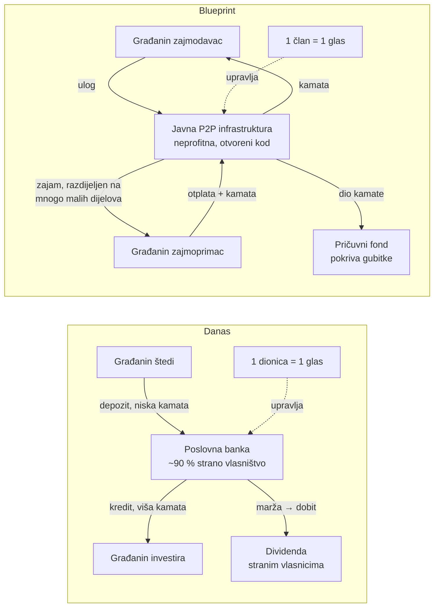
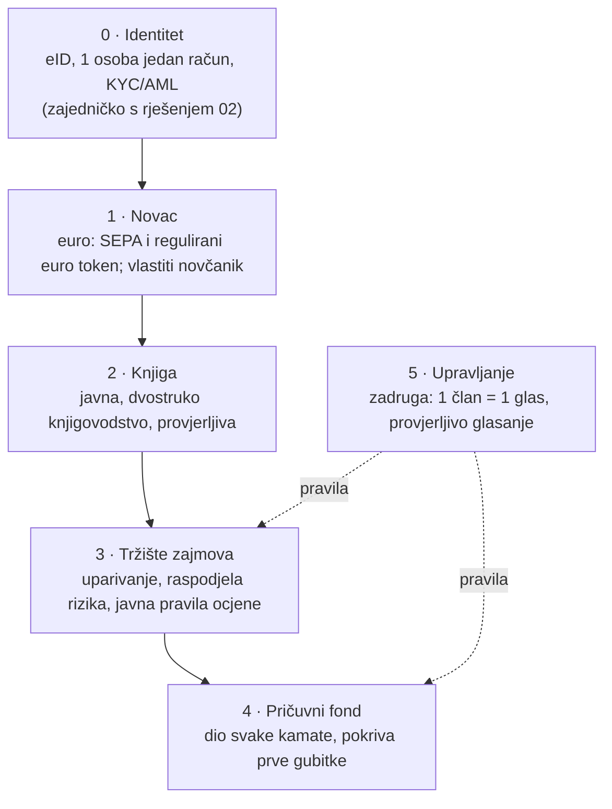
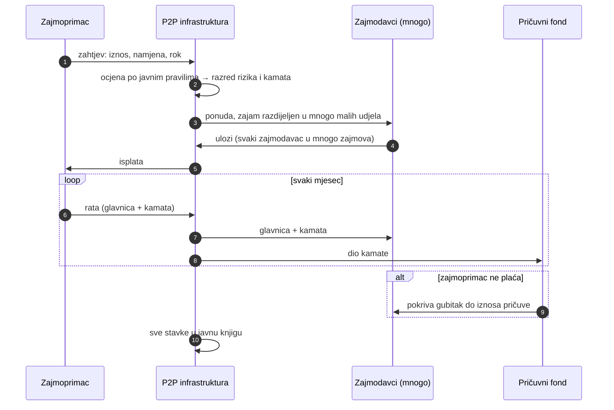
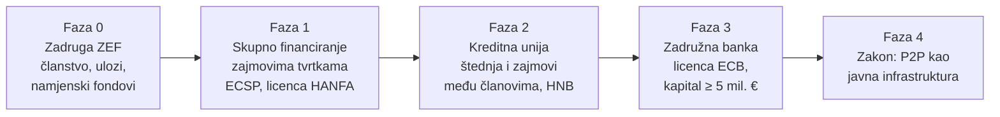

# 3. Rješenje: P2P likvidnost kao javna infrastruktura

Blueprint, ne implementacija. Problem je opisan u
[01 — lanac B](01-trenutno-stanje.md). Gradivni blokovi su u
[04](04-gradivni-blokovi.md).

## Načelo

> Pristup likvidnosti je javna infrastruktura, kao cesta: gradi se za
> sve, upravlja se po načelu **1 član = 1 glas**, i ne služi privatnom
> bogaćenju. **Kamata ostaje kod onih koji nose rizik i u zajedničkoj
> pričuvi, ne odlazi dioničarima.**

## Danas i blueprint, jedno uz drugo

## Kriteriji pravednosti

„Objektivno pravedno" ovdje znači da se svako od ovih pravila može
provjeriti:

| # | Kriterij | Danas | Blueprint |
|---|---|---|---|
| 1 | Tko dobiva kamatu | Banka (marža), pa dioničari | Zajmodavci koji nose rizik + pričuvni fond |
| 2 | Tko upravlja | Kapital (1 dionica = 1 glas) | Članovi (1 član = 1 glas) |
| 3 | Kamo ide višak | Dividenda, većinom u inozemstvo | Pričuva, niže kamate, javna namjena; nikad dividenda |
| 4 | Transparentnost | Poslovna tajna | Javna knjiga: svaki zajam, kamata, gubitak (anonimizirano) |
| 5 | Pristup | Banka odlučuje po svojim pravilima | Javna, objavljena pravila ocjene; žalba članstvu |
| 6 | Vlasništvo infrastrukture | Privatno | Javno dobro: otvoreni kod, ne može se prodati |

## Slojevi

## Život jednog zajma, korak po korak

## Uloga države

Proračun je u deficitu, pa država **nije izvor novca** za zajmove. Njena
uloga je infrastruktura i pravila, ne kapital:

| Uloga | Kako | Postojeći presedan |
|---|---|---|
| Infrastruktura | Javna platforma, kao e-Građani ili FINA | e-Građani, FINA |
| Izravan tok | Ako građani mogu izravno posuditi državi, mogu i jedni drugima | Narodna obveznica 2023.: 44.843 građana, 1,335 mlrd € |
| Jamstvo prvog gubitka | Razvojna banka pokriva dio gubitka umjesto da ide preko poslovnih banaka | HBOR |
| Pravila | Zakonski okvir za P2P kao javnu infrastrukturu | Zakon o kreditnim unijama, ECSP |

## Pravni put u fazama

Svaka faza je legalna sama po sebi i ne čeka sljedeću.

| Faza | Što je moguće | Ograničenje |
|---|---|---|
| 0 | Članstvo 1 član = 1 glas, uplate, namjenski fondovi | Nema zajmova ni štednje |
| 1 | Građani posuđuju **tvrtkama** preko licencirane platforme [S20] | Do 5 mil. € po nositelju projekta u 12 mjeseci; nema potrošačkih zajmova; ulog nije osiguran |
| 2 | Štednja i zajmovi **među članovima** | Uvjeti iz Zakona o kreditnim unijama **[provjeriti: kapital, ograničenja]** |
| 3 | Puna banka: depoziti osigurani, kredit svima | 5 mil. € kapitala, odobrenje ECB-a; tu je ZEF zapeo 2017. |
| 4 | P2P kao javna infrastruktura po zakonu | Politička odluka (veza s rješenjem [02](02-rjesenje-1-osoba-1-glas.md)) |

## Rizici, iskreno

- **Ulog u P2P zajam nije depozit.** Ne pokriva ga osiguranje depozita do
  100.000 €. Pričuvni fond ublažava, ali ne uklanja rizik. To se mora pisati
  na svakom ekranu.
- **Kreditni rizik.** Bez dobre ocjene gubici pojedu kamatu. Javna pravila
  ocjene moraju se provjeravati na podacima i mijenjati glasanjem.
- **Prijevare i pranje novca.** KYC/AML vrijedi kao i za banke (sloj 0).
- **Preuzimanje upravljanja.** 1 član = 1 glas štiti od kapitala, ali ne od
  organiziranih skupina; potrebni su kvorumi i javni zapisnici.
- **Stvaranje novca.** Banka kreditom stvara novac; P2P samo premješta
  postojeću štednju. P2P zato **nadopunjuje**, a ne zamjenjuje banku sve do
  faze 3.
- **Porez na kamatu** i računovodstvo za građanina zajmodavca moraju biti
  automatski, inače je ulazni prag previsok **[provjeriti porezni tretman]**.
