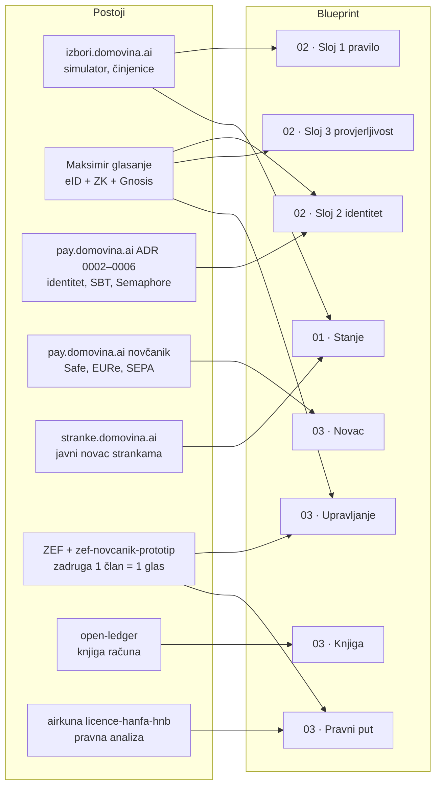

# 4. Gradivni blokovi: što već postoji i kako se poopćuje

Ovaj repo ne implementira ništa. Ovdje je samo karta postojećih projekata u
ekosustavu domovina.ai i njihovo mjesto u blueprintu. Stanje 2026-10-18.

| Blok | Gdje | Zrelost | Poopćenje |
|---|---|---|---|
| Izborni simulator i činjenice | `domovinatv/izbori.domovina.ai` (`web/lib/sim/`, `docs/izborni_sustav_cinjenice.md`) | U produkciji; reproducira 2020. i 2024. mandat za mandat | Izračunati opcije A–E iz [02](02-rjesenje-1-osoba-1-glas.md) i objaviti Gallagher i propale glasove za svaku |
| Glasanje 1 osoba = 1 glas | `stadion-maksimir/stadion-maksimir-natjecaj-2026` | U produkciji od 25. 9. 2026. | Izvući iz konteksta natječaja: opći modul za bilo koje glasanje (zadruga, inicijativa, savjetovanje) |
| Identitet bez duplikata | `domovinatv/pay.domovina.ai/docs/decisions/` 0002–0006, 0023 | Dizajn (Accepted) | Zajednički sloj 0 za oba rješenja |
| Euro novčanik | `domovinatv/pay.domovina.ai` | U produkciji | Sloj „novac" P2P infrastrukture; namjenski Safe po zajmu |
| Knjiga računa | `minka/open-ledger` | Server s testovima | Javna knjiga zajmova |
| Zadruga i ZEF novčanik | `zef/zef-novcanik-prototip` (`VISION.md`, `BLUEPRINT.md`, `docs/compliance/`) | Prototip | Pravni nositelj faza 0–3 |
| Pravna analiza licenci | `airkuna/airkuna-web/research/licence-hanfa-hnb.md` | Analiza 1. 8. 2026. | Proširiti na zajmove: ECSP i kreditne unije |
| Javni novac strankama | `domovinatv/stranke.domovina.ai` | U produkciji | Veza izbornog sustava i proračuna u [01](01-trenutno-stanje.md) |

## Praznina

Ni u jednom postojećem projektu nema:

- modela zajma (ugovor, otplatni plan, raspodjela na udjele),
- javnih pravila ocjene kreditnog rizika,
- modela pričuvnog fonda i raspodjele kamate,
- pravne analize za faze 1 i 2 (ECSP, kreditna unija).

To su teme za sljedeće iteracije blueprinta [03](03-rjesenje-p2p-likvidnost.md).
