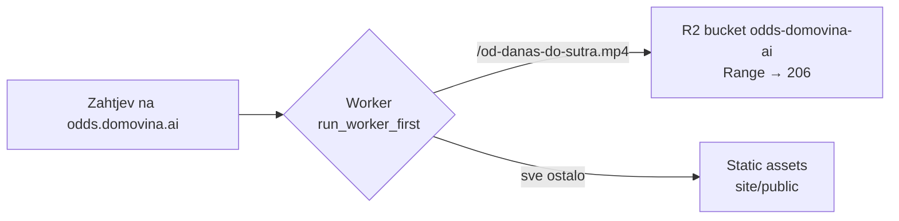

# Landing na odds.domovina.ai (2026-10-18)

Kako je postavljen landing s videom i što je koštalo vremena. Upute za novi
render su u [README](../README.md#web-oddsdomovinaai).

- Račun: D.O.M. (`7dc7167b7e2e00923bfa7cd697df14e4`), Worker `odds-domovina-ai`,
  custom domena, `workers_dev` i preview URL-ovi isključeni (kao energy.domovina.ai).
- Video je kopija rendera iz `hyperframes-domovina-ai`, preslagan s
  `-movflags +faststart` (moov na početak, da se pusti prije punog downloada).
  Poster i OG slika su kadar sa 7. s („Tvoj glas vrijedi 1").

## Zamke

- **Static assets ne podržavaju Range.** Prvi deploy (samo asseti) na
  `Range: bytes=0-99` vraćao je `200` i cijelih 15,5 MB, bez `accept-ranges`.
  Safari/iOS bez `206` ne puštaju `<video>`. Rješenje: video u R2, Worker s
  `env.BUCKET.get(key, { range: request.headers, onlyIf: request.headers })`.
  Provjereno: `bytes=0-99` → 206, sufiks `bytes=15471800-` → 206, bez Range → 200.
- **Lokalni DNS pamti negativan odgovor.** Domena je provjeravana (`curl` → 000)
  prije deploya, pa ju je macOS resolver nastavio vraćati kao nepostojeću i
  nakon deploya. Testirati s `--resolve odds.domovina.ai:443:<IP iz dig @1.1.1.1>`
  ili isprazniti cache: `sudo dscacheutil -flushcache; sudo killall -HUP mDNSResponder`.
- **`git mv -k` na netrackanoj datoteci tiho ne radi ništa** (exit 0), pa je
  sljedeći `wrangler r2 object put` pao jer datoteke nije bilo na novom mjestu.
- **`npx playwright install chromium` je visio >5 min** na `__dirlock` u
  `~/Library/Caches/ms-playwright`. Zaobiđeno s `executablePath` na već
  skinuti `chromium-1243`.

## Otvoreno

- Puštanje na pravom iPhoneu nije isprobano (provjeren samo 206 odgovor).
- Video na YouTubeu nije objavljen; kad bude, landing može dobiti i YouTube link.

Vezani dokumenti: [06 Iteracije](06-iteracije.md).
